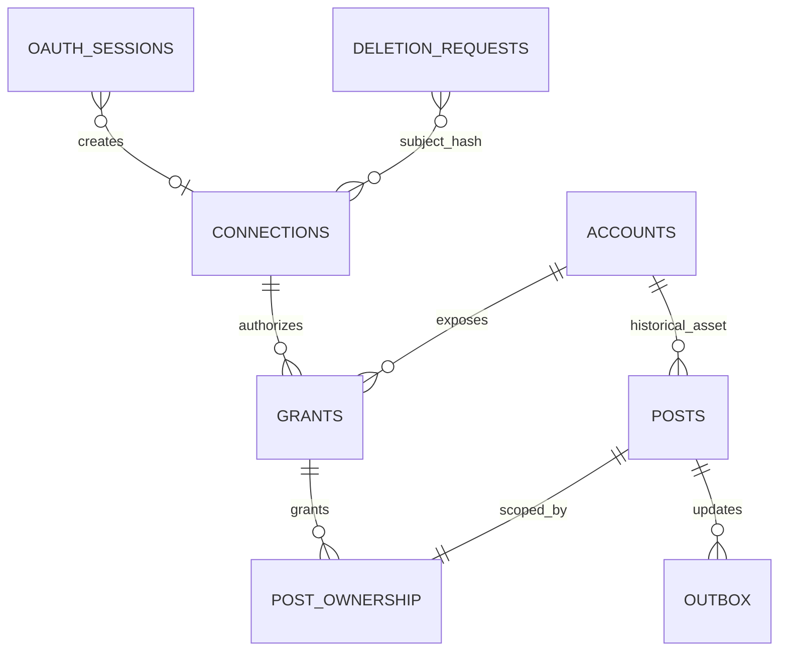

# Architecture

Tiko authenticates users and owns agencies/clients, media and UI. Publisher authenticates the service, verifies its context and independently checks every asset/publication grant. UUIDs identify internal resources; external IDs stay strings. API timestamps use epoch seconds, Tiko item timestamps use milliseconds.

Accounts are shared asset identities, not shared credential owners. Grant tokens belong to individual connections. Global historical account tokens remain untouched until explicitly backfilled; new assets have no global token. API responses are projections, never `SELECT *` of credential tables. Legacy records remain in place but are denied via private routes until verified mapping.

SQLite immediate transactions serialize idempotency, selection and local events. Compare-and-set claims plus a renewable five-minute lease own each job. Expired publishing leases become `reconciling`, including legacy jobs with unknown mutation progress. Cancellation succeeds only from pending (or is idempotent when already cancelled). Publication, upload and processing are separate stages. Facebook async video completion is read-only reconciled; unknown mutations require operator investigation.

Outbox bodies persist with state changes and are signed only at delivery. Failures back off exponentially, with jitter and one-day maximum. Consumers deduplicate eventId and reconcile state when delivery order is uncertain. Diagnostics check identity only and never create/publish media.

The new tables are defined in the explicit additive migrator `src/db/migrate.ts`. Existing Drizzle account/post mappings remain for historical tooling; never use schema push to remove tables not represented in old snapshots.
